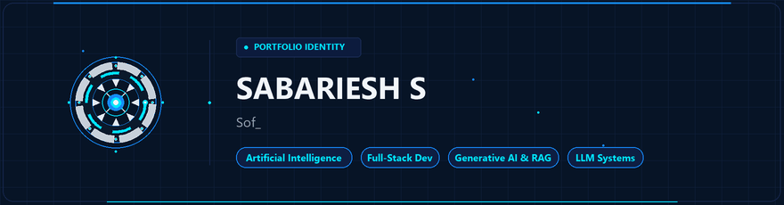
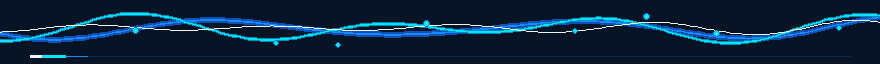
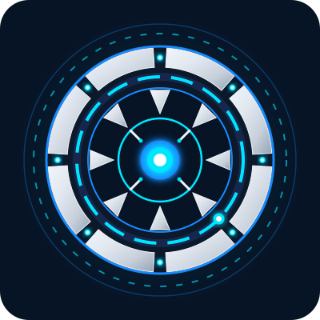

  <!-- Hero Banner: Restrained animated GIF with static SVG fallback -->
  <picture>
    <source media="(prefers-reduced-motion: reduce)" srcset="assets/hero-banner.svg">
    
  </picture>

    

  <!-- Quick Social Connect -->
  
  &nbsp;
  
  &nbsp;
  

    
  
  <picture>
    <source media="(prefers-reduced-motion: reduce)" srcset="assets/divider.svg">
    
  </picture>

## 📌 About Me

  <picture>
    <source media="(prefers-reduced-motion: reduce)" srcset="assets/about-me-visual.svg">
    
  </picture>

 

I am an **MSc Software Systems** student focused on building robust full-stack platforms and applying modern **Artificial Intelligence** systems to solve practical problems.

My work spans responsive web applications, distributed backend services, and AI architectures like **Retrieval-Augmented Generation (RAG)** and **Large Language Models**. I enjoy experimenting with emerging developer frameworks, refining architecture, and transforming complex technical ideas into clean, functional tools.

 

* 🎓 **Academic Path:** **MSc Software Systems** — spanning advanced software architecture, algorithmic design, and distributed computational systems.
* 🧠 **Specialized Focus:** **AI & Full-Stack Systems** — architecting practical LLM applications, dense vector RAG pipelines, microservice backends, and responsive user interfaces.
* 🛠️ **Engineering Approach:** **Pragmatic Engineering** — clean code conventions, decoupled service architecture, verified technical execution, and continuous hands-on exploration.

 

  <picture>
    <source media="(prefers-reduced-motion: reduce)" srcset="assets/divider.svg">
    
  </picture>

## 🛠️ Tech Stack

<table width="100%">
  <tr>
    <td width="50%" valign="top">
      <h4 align="left">💻 Languages &amp; Core Web</h4>
      

        
        
         
        
        
      

    </td>
    <td width="50%" valign="top">
      <h4 align="left">⚡ Frontend &amp; Backend Frameworks</h4>
      

        
        
         
        
        
      

    </td>
  </tr>
  <tr>
    <td width="50%" valign="top">
      <h4 align="left">🗄️ Databases &amp; Cloud Services</h4>
      

        
        
         
        
        
        
      

    </td>
    <td width="50%" valign="top">
      <h4 align="left">🛠️ Developer Tools &amp; AI Technologies</h4>
      

        
        
        
         
        
        
      

    </td>
  </tr>
</table>

 

  <picture>
    <source media="(prefers-reduced-motion: reduce)" srcset="assets/divider.svg">
    
  </picture>

## 🚀 Featured Projects

<table width="100%">
  <tr>
    <td width="50%" valign="top">
      <h3>⚖️ FairLens</h3>
      
<b>AI-powered Hiring Fairness &amp; Compliance Platform</b> — designed to identify potential recruitment bias, promote equitable hiring practices, and support compliance through AI-driven evaluation.

      
<b>Tech Stack:</b> <code>React</code> • <code>Node.js</code> • <code>Express</code> • <code>MongoDB</code>

      
🔗 <a href="https://github.com/sabarieshsk-collab/Fairlens"><b>View Repository →</b></a>

    </td>
    <td width="50%" valign="top">
      <h3>🔐 LexChain eVault</h3>
      
Blockchain-based eVault for legal records, engineered for cryptographic authenticity verification and tamper-resistant document management.

      
<b>Tech Stack:</b> <code>Blockchain</code> • <code>JavaScript</code> • <code>Smart Contracts</code> • <code>JWT &amp; RBAC</code>

      
🔗 <a href="https://github.com/sabarieshsk-collab/Lexchain-e-valut"><b>View Repository →</b></a>

    </td>
  </tr>
  <tr>
    <td width="50%" valign="top">
      <h3>📜 Sanskrit Translation Website</h3>
      
AI-powered translation platform converting classical Sanskrit into contextual English by combining Indian Knowledge Systems (IKS) and IndicTrans2.

      
<b>Tech Stack:</b> <code>Python</code> • <code>NLP</code> • <code>IndicTrans2</code> • <code>Web Technologies</code>

      
🔗 <a href="https://github.com/sabarieshsk-collab/sanskrit-translation-"><b>View Repository →</b></a>

    </td>
    <td width="50%" valign="top">
      <h3>📄 PDF RAG Chatbot</h3>
      
Streamlit-based RAG assistant allowing users to upload PDFs, perform semantic vector searches, and receive grounded answers with exact page citations.

      
<b>Tech Stack:</b> <code>Python</code> • <code>Streamlit</code> • <code>LangChain / RAG</code> • <code>Vector Index</code>

      
🔗 <a href="https://github.com/sabarieshsk-collab/pdf-rag-chatbot"><b>View Repository →</b></a>

    </td>
  </tr>
</table>

 

  <picture>
    <source media="(prefers-reduced-motion: reduce)" srcset="assets/divider.svg">
    
  </picture>

## 🔭 Currently Exploring

* 🤖 **Generative AI & LLMs:** Advanced prompt engineering, reasoning workflows, and function-calling agentic architectures.
* 🔍 **RAG Pipelines:** Hybrid retrieval pipelines integrating dense vector search with lexical scoring for hallucination-resistant Q&A.
* 🌐 **Full-Stack Engineering:** Scalable JavaScript/TypeScript architectures, REST APIs, and modern reactive frontends.
* ☁️ **Cloud Infrastructure:** Serverless deployments, continuous integration, and managed database management.

 

  <picture>
    <source media="(prefers-reduced-motion: reduce)" srcset="assets/divider.svg">
    
  </picture>

## 📊 GitHub Analytics

  <table border="0" cellspacing="0" cellpadding="0">
    <tr>
      <td align="center" valign="middle">
        
      </td>
      <td align="center" valign="middle">
        
      </td>
    </tr>
  </table>

 

  <picture>
    <source media="(prefers-reduced-motion: reduce)" srcset="assets/divider.svg">
    
  </picture>
    
  
  
  
  

    <b>SABARIESH S</b>
  

